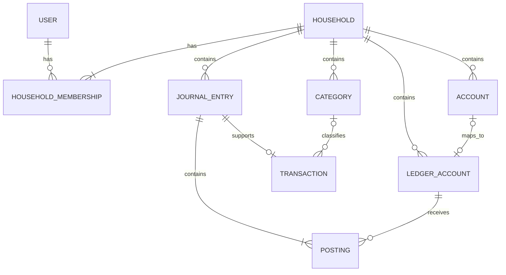

# FinTrack Financial Domain and Privacy

This document records the agreed domain boundaries, privacy rules, and relational design for the planned MVP financial model.

## ARC-01 — Domain Boundaries and Terminology

| Concept | Responsibility |
| --- | --- |
| `Account` | A financial account the user manages, such as checking, savings, or cash. It belongs to a household and carries its display name, type, and visibility. Its balance is derived from postings to its mapped ledger account. |
| `LedgerAccount` | A bookkeeping account that receives postings. Each `Account` maps to its own `asset` ledger account. The ledger also uses internal `income`, `expense`, and `opening equity` accounts. |
| `Transaction` | The user-facing record of income, an expense, or a transfer. It carries business context such as type, business date, actor, and category where applicable. It links to its journal entry, which supplies the financial amounts. |
| `JournalEntry` | A complete accounting record for a financial event. All its postings are recorded atomically, and total debits equal total credits. |
| `Posting` | One line in a journal entry. It names a ledger account, a `debit` or `credit` side, and a positive amount in integer EUR cents. A debit increases an asset balance and a credit decreases it. |

The following examples use an existing checking balance and an empty savings account. Each event creates one `JournalEntry` and two `Posting` records.

| Event | User-facing activity | `Transaction` created | Debit | Credit |
| --- | --- | --- | --- | --- |
| €200 opening balance | Opening balance on checking | No | `Checking` 20,000 cents | `Opening Equity` 20,000 cents |
| €1,000 salary payment | One income item on checking | Yes | `Checking` 100,000 cents | `Income` 100,000 cents |
| €40 grocery purchase | One expense on checking | Yes | `Expense` 4,000 cents | `Checking` 4,000 cents |
| €50 transfer from checking to savings | One transfer, shown as €50 out in checking history and €50 in in savings history | Yes | `Savings` 5,000 cents | `Checking` 5,000 cents |

The final balances are €1,110 in checking and €50 in savings. The income and expense totals are €1,000 and €40. Opening balances and transfers affect account balances and are excluded from income and expense totals.

A user can start with a single checking account, such as a Croatian bank's EUR current account. An ordinary debit card purchase is recorded as an expense on that account. Card registration and separate tracking of cards, credit limits, and credit card debt are deferred beyond the MVP.

## ARC-02 — Household Roles and Privacy

The `owner` and `member` roles apply within a household. A private account is accessible only to its account owner, who must be an active member of the same household. A household owner has no special access to another person's private account.

| Action | Household `owner` | Household `member` | No active membership |
| --- | --- | --- | --- |
| Manage household settings, invitations, and membership | Yes | No | No |
| View and post to own private account | Yes | Yes | No |
| View or post to someone else's private account | No | No | No |
| View shared accounts, balances, and history | Yes | Yes | No |
| Record income or expenses on an active shared account | Yes | Yes | No |
| Open, rename, or archive an account | Own private accounts and shared accounts | Own private accounts | No |

Account visibility is set at creation. Access ends immediately when membership ends. Account detail, search, reports, and exports use the same authorized scope. Balance totals include only accounts the viewer can access.

A transfer requires two distinct accounts in the same household and permission to post to both. Reversing a transfer requires permission to post to both accounts as well. When a viewer can see only one side, the record shows the visible account's direction, amount, and date. It omits the hidden account's name, identifier, and balance, along with any note that could identify it.

- **Allowed.** Ana, a `member`, transfers €50 from her private checking account to a shared account. She can see both sides. Marko, an `owner` of the household, sees the incoming €50 transfer and its date on the shared account.
- **Denied.** Marko cannot open Ana's private account through a direct link or reverse the transfer. The shared account activity remains visible to him.
- **Denied.** Ana cannot transfer directly between accounts in two different households, even if she is an active member of both.

## ARC-03 — Initial ERD and Integrity Constraints

Each financial record belongs to one household. Tables use a single-column primary key `id`. Required household references carry a non-null `household_id`. Relationships between records in the same household use a composite foreign key on `(household_id, related_id)` against the target's unique `(household_id, id)` pair.

| Relationship | Constraint |
| --- | --- |
| `HouseholdMembership` → `User`, `Household` | Both references are required. `UNIQUE (household_id, user_id)` allows one membership record per user and household. The record carries the `owner` or `member` role and is retained when deactivated. |
| `Account` → owning membership | A private account requires `(household_id, owner_user_id)` to match a membership. A shared account belongs to the household with an empty `owner_user_id`. The application checks active membership and enforces the ARC-02 permissions. |
| `LedgerAccount` → `Account` | An `asset` ledger account requires an `account_id` in the same household. Internal ledger accounts leave `account_id` empty. Uniqueness on the mapping allows at most one asset ledger account per financial account. Once the ledger is enabled, account creation also creates its asset ledger account. |
| `Posting` → `JournalEntry`, `LedgerAccount` | Both references are required and use the posting's `household_id`, so the journal and ledger account must belong to the same household as the posting. |
| `Transaction` → `JournalEntry`, `Category` | Each transaction references one journal entry in its household. The journal link is unique, so a journal entry has at most one transaction. An opening balance has a journal entry without a transaction. A category reference, when present, must be in the same household. |
| `Category` → parent `Category` | A parent is optional. If present, it must belong to the same household. |

Use `ON DELETE RESTRICT` for references that preserve membership, account ownership, or financial history. An archived account retains its history, and deactivating a membership removes access while preserving the membership record. ARC-04 covers the separate rules that protect posted entries and postings from changes.

### Relationship Walkthrough

- **Valid transfer.** Ana transfers €50 from her private checking account to a shared account in household A. The transaction links to a journal in A. Both postings link to that journal and to their respective ledger accounts in A.
- **Rejected reference.** Substituting a destination ledger account from household B fails because `(A, destination_ledger_account_id)` does not exist as a ledger account pair.
- **Denied access within a household.** Marko's attempt to post from Ana's private account in household A can satisfy the foreign keys. The application denies the operation under ARC-02.

## ARC-04 — Financial and Temporal Invariants

### Money and Posting

- Store EUR amounts as integer cents and use exact arithmetic. For example, €40.25 is 4,025 cents. Reject amounts with more than two decimal places or outside the supported range.
- A `Posting` has a positive amount and an explicit `debit` or `credit` side. A valid `JournalEntry` has at least two postings in one household, with equal total debits and credits.
- Commit the journal entry, its postings, and its `Transaction` when applicable in one database transaction. A failure rolls back the entire operation.
- Derive asset balances by subtracting credits from debits. A cash account must have a nonnegative closing balance on each business date. For a backdated entry, check each affected closing balance. Bank account balances may be negative.
- Record at most one opening journal entry per account. A positive opening balance debits the asset account and credits `Opening Equity`. An allowed negative balance uses the opposite sides. A zero opening balance creates no journal entry.

### Business Dates and Corrections

- `business_date` determines which day an event affects in balances and reports. Default to the current date in `Europe/Zagreb`. Ordinary events can be posted with an earlier business date. Future events belong to planning.
- `posted_at` records the actual posting instant in UTC for audit purposes. A balance as of a business date includes all posted entries with a business date on or before that date.
- Posted financial fields and postings are immutable. A reversal is a new journal entry linked to the original, with the same ledger accounts and amounts, opposite posting sides, an actor, and a reason. An original can be reversed at most once.
- Use the business date of the correction for the reversal. When a correction includes a replacement, post the reversal and the replacement together on that date in one database transaction.
- Calculate net income as credits less debits on income accounts and net expenses as debits less credits on expense accounts. An expense reversal reduces net expenses in its own reporting period. Opening balances and transfers are excluded from both totals.

### Idempotency

Scope each idempotency key to the actor within the household. A retry with the same key and the same business inputs returns the result of the first successful operation. A retry with changed inputs is rejected. Concurrent requests using the same key can commit only one operation. An unsuccessful operation leaves no partial financial records and can be retried.

### Manual Verification

Both accounts belong to the same household and are visible to the viewer.

| Business date | Event | Checking balance | Savings balance |
| --- | --- | ---: | ---: |
| 2026-03-01 | Open checking with €200 | €200 | €0 |
| 2026-03-05 | Receive €1,000 in salary | €1,200 | €0 |
| 2026-03-28 | Spend €40 on groceries | €1,160 | €0 |
| 2026-03-30 | Transfer €50 from checking to savings | €1,110 | €50 |
| 2026-04-02 | Reverse the grocery expense | €1,150 | €50 |

March closes with €1,160 across the accounts, €1,000 in net income, and €40 in net expenses. The April reversal debits checking and credits `Expense` by €40. With no other April activity, April closes with €1,200 across the accounts, €0 in net income, and −€40 in net expenses. March's figures are unchanged by the April reversal. Replaying the March transfer with the same key and inputs leaves €50 in savings.
