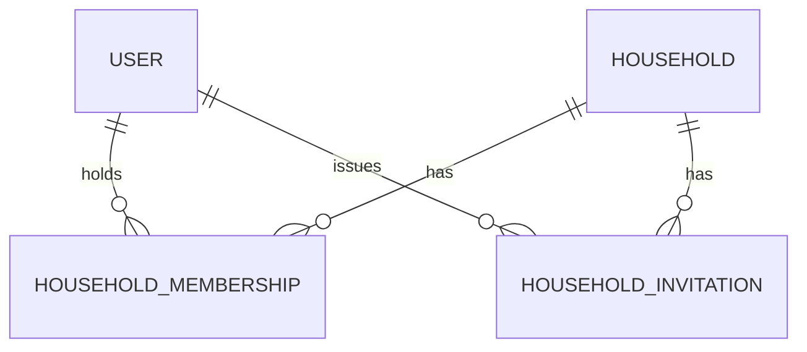

# FinTrack Household Module

This document describes the implemented household, membership, and invitation flows through HH-05. The implementation was reviewed on `feat/households` at commit `21147a3` (`feat(households): implement secure invitation acceptance flow`). Automated results below were reproduced against that revision on 26 November 2026.

A household groups users through explicit membership records. Its creator becomes an owner; an invited user joins as a member after accepting with the intended verified identity. Membership records are retained for reactivation, and invitation acceptance updates membership and consumes the invitation atomically.

See [ARCHITECTURE.md](../ARCHITECTURE.md) for the planned financial domain and privacy rules, [AUTHENTICATION.md](../AUTHENTICATION.md) for authentication and email verification, and [UI-UX.md](../UI-UX.md) for the agreed interface direction. Those design documents include future work; this document records the current implementation.

## Implementation Structure

| Component | Responsibility |
| --- | --- |
| [`CreateHousehold`](../../app/Actions/Households/CreateHousehold.php) | Create the household and its initial owner membership in one transaction. |
| [`ResolveActiveHousehold`](../../app/Actions/Households/ResolveActiveHousehold.php) | Resolve the household selected in the session and clear a selection whose membership no longer exists. |
| [`CreateHouseholdInvitation`](../../app/Actions/Households/CreateHouseholdInvitation.php) | Check invitation eligibility, issue or replace a hashed token, and send the invitation email. |
| [`AcceptHouseholdInvitation`](../../app/Actions/Households/AcceptHouseholdInvitation.php) | Validate the recipient and invitation, create or reactivate membership, and record acceptance atomically. |
| [`HouseholdController`](../../app/Http/Controllers/HouseholdController.php) | Handle household creation, authorized activation, and invitation issuance. |
| [`HouseholdInvitationController`](../../app/Http/Controllers/HouseholdInvitationController.php) | Render the confirmation page and submit acceptance to the action. |
| [`ProtectInvitationResponse`](../../app/Http/Middleware/ProtectInvitationResponse.php) | Apply cache and referrer protections to invitation responses. |
| [`HouseholdInvitationMail`](../../app/Mail/HouseholdInvitationMail.php) and [`Show.vue`](../../resources/js/pages/Households/Invitations/Show.vue) | Deliver the confirmation link and provide the minimal acceptance form. |

Controllers handle HTTP concerns. Form requests validate input and, for invitation issuance, authorize the actor. Actions implement the domain operations. Invitation state predicates live on the invitation model.

## Domain Model and Database Constraints



| Model and table | Stored fields and relationships | Integrity rules |
| --- | --- | --- |
| [`Household`](../../app/Models/Household.php), `households` | `id`, `name`, timestamps; `memberships()` is a `hasMany` relationship. | Creation also creates an owner membership through the action. |
| [`HouseholdMembership`](../../app/Models/HouseholdMembership.php), `household_memberships` | `id`, `household_id`, `user_id`, `role`, nullable `deactivated_at`, timestamps; belongs to a household and user. | Unique `(household_id, user_id)`; role is `owner` or `member`; both foreign keys restrict deletion of their referenced records. |
| [`HouseholdInvitation`](../../app/Models/HouseholdInvitation.php), `household_invitations` | `id`, `household_id`, `invited_by_user_id`, `email`, `token_hash`, `expires_at`, nullable `accepted_at`, timestamps; `household()` and `invitedBy()` identify the household and issuer. | Unique `(household_id, email)` and unique 64-character `token_hash`; both foreign keys cascade on deletion. |
| [`User`](../../app/Models/User.php) | `householdMemberships()` exposes the user's membership records. | The user implements email verification; acceptance requires a verified email address. |

The schema is defined by the [household](../../database/migrations/2026_11_22_092440_create_households_table.php), [membership](../../database/migrations/2026_11_22_092508_create_household_memberships_table.php), [invitation](../../database/migrations/2026_11_23_150312_create_household_invitations_table.php), and [acceptance timestamp](../../database/migrations/2026_11_24_133424_add_accepted_at_to_household_invitations_table.php) migrations. `accepted_at` defaults to `null`. The invitation model casts `expires_at` and `accepted_at` to datetimes.

An invitation targets an email address rather than a recipient foreign key, so the recipient does not need an account when it is issued. The invitation has no role field. Its issuer is recorded independently of the user who later accepts it.

## Membership Lifecycle

Creating a household inserts its initial `owner` membership in the same transaction. A failure that throws during membership persistence rolls back the household as well. Users can belong to multiple households, with a separate role in each.

Membership activity is determined by `deactivated_at`: `null` means active; a non-null timestamp means deactivated. Invitation acceptance follows these rules:

| Existing membership in the invited household | Acceptance behavior |
| --- | --- |
| No membership | Create an active membership with role `member`. |
| Deactivated membership | Reuse its existing ID, clear `deactivated_at`, and set role to `member`. |
| Deactivated former owner | Reactivate as `member`; ownership is not restored. |
| Active member or owner | Reject acceptance and leave the membership and invitation unchanged. |

Issuing an invitation does not create or reactivate membership. Only successful acceptance changes membership. Other households' memberships do not prevent an invitation.

The schema and acceptance action support retained, deactivated membership records. There are no public leave, removal, membership-deactivation, or role-management routes at this revision. HH-06 is planned to add safe membership lifecycle operations and last-owner protection.

### Active Household Selection

`POST /households/{household}/activate` checks that the signed-in user has an active membership in the route-bound household. On success it stores `active_household_id` in the session. An unauthorized attempt returns HTTP 403 and leaves the previous selection intact. Household identifiers submitted in the request body cannot override the route-bound model.

`ResolveActiveHousehold` returns `null` when there is no selection. When the selected household has no membership for the user, it clears the session key and returns `null`; otherwise it loads the household.

The resolver currently checks membership existence without filtering `deactivated_at`. It is also not wired into request middleware or shared Inertia props. It must not be used as proof of active membership. Household creation and invitation acceptance do not automatically select a household.

## Invitation Lifecycle

### State Predicates

There is no persisted status column. The model derives state from its timestamps:

| Predicate | Definition |
| --- | --- |
| `isAccepted()` | `accepted_at !== null` |
| `isExpired()` | `expires_at <= now()` |
| `isPending()` | Not accepted and not expired |

An invitation expires exactly at `expires_at`. An accepted invitation remains accepted after its expiry time; both `isAccepted()` and `isExpired()` can be true. Acceptance checks the accepted state before expiry, so a used invitation reports that it has already been accepted.

### Issuance and Replacement

[`StoreHouseholdInvitationRequest`](../../app/Http/Requests/StoreHouseholdInvitationRequest.php) trims and lowercases a string email before validating it as required, string, and email. It authorizes only an active `owner` membership in the route-bound household. Active ordinary members, deactivated owners, and owners of another household are forbidden.

The issuance action generates a 64-character token with `Str::random(64)`, then opens a database transaction and locks the household row. Within that transaction it:

1. Rejects an email belonging to an active membership in that household.
2. Looks up the invitation for the household and normalized email.
3. Rejects an existing pending invitation without sending another email.
4. Creates a new invitation or replaces an expired or accepted invitation in the same row.

Each issuance stores `hash('sha256', $token)` and sets `expires_at` to `now()->addHours(24)`. Replacement rotates the hash, updates the issuer and expiry, and clears `accepted_at`. It preserves the row ID and original `created_at`, so expiry is measured from the latest issuance rather than the original creation timestamp. The old link stops matching the stored hash.

The active-membership check runs before replacement eligibility. An accepted invitation can be reissued for a former, deactivated member, but cannot bypass the rejection of a currently active member. Deactivated membership stays deactivated until acceptance.

After the transaction completes, the action synchronously sends `HouseholdInvitationMail` to the normalized address. The [mail template](../../resources/views/mail/households/invitation.blade.php) contains the named confirmation route and explains the 24-hour lifetime. The raw token is available to the mailable; only its hash is stored in the invitation table.

### Acceptance

Opening the GET link only renders a generic confirmation page. It does not look up the invitation, validate its recipient or state, or create membership. Any token segment can reach this page for an authenticated, verified user; authoritative validation happens on POST.

[`AcceptHouseholdInvitationRequest`](../../app/Http/Requests/AcceptHouseholdInvitationRequest.php) requires a string token of exactly 64 characters. The action then:

1. Requires the supplied user to have a verified email, including when called outside HTTP.
2. Hashes the token with SHA-256 and performs an initial invitation lookup.
3. Starts a transaction and locks the household, then re-reads and locks the invitation by both ID and token hash.
4. Compares the user's email with the invitation email after trimming and lowercasing both.
5. Rejects accepted or expired invitations.
6. Locks any existing membership and creates or reactivates it according to the membership lifecycle.
7. Sets `accepted_at = now()` and returns the membership after commit.

An unknown token and a wrong recipient both receive the generic `token` validation error `This invitation is invalid.` Recipient matching precedes state disclosure. Expired, already accepted, and already active membership cases use their own `token` validation errors. The action-level unverified-user error is attached to `email`; HTTP requests are intercepted earlier by verification middleware.

A repeated successful submission is rejected as already accepted. This provides single-use acceptance rather than a successful idempotent replay response.

## Transactions and Locking

| Operation | Transaction boundary and locks |
| --- | --- |
| Household creation | Household and initial owner membership are inserted together. |
| Invitation issuance | Lock household, check active membership and existing invitation, then insert or replace the invitation. Email delivery occurs after this transaction. |
| Invitation acceptance | Lock household, lock the invitation using ID and hash, lock an existing membership, then persist membership and `accepted_at` together. |

Issuance and acceptance share the household row as their first lock. This serializes those operations within one household, including when no membership row exists yet. The unique membership and invitation constraints provide additional database enforcement. Operations on different households do not use the same household row lock.

The initial acceptance lookup occurs outside the transaction and is not trusted as the final state. Rechecking the hash after obtaining the household lock rejects a token rotated by another issuance. Re-reading the locked invitation makes a later acceptance observe an earlier acceptance's `accepted_at`. New mutation paths must participate in the same locking order to preserve these guarantees.

The acceptance action checks the return value of each membership and invitation `save()`. A false result throws a `RuntimeException`, ensuring rollback even when an Eloquent event cancels a save without throwing. Database exceptions also roll back the transaction. Failed acceptance therefore leaves no newly created membership, no partial reactivation or role change, and no newly consumed invitation.

These locks implement concurrency control, but the current tests do not execute simultaneous requests or independent database connections. The test suite establishes sequential business rules and rollback behavior; it does not independently demonstrate all race outcomes.

## HTTP Routes and Authorization

All five routes are declared in [`routes/web.php`](../../routes/web.php) and use the browser `web` middleware stack, including sessions and request-forgery protection.

| Method and path | Route name | Access and input | Successful response |
| --- | --- | --- | --- |
| `POST /households` | `households.store` | `auth`; `name` is required, string, maximum 255 characters. | Redirect back after household and owner creation. |
| `POST /households/{household}/activate` | `households.activate` | `auth`; active membership in the route-bound household. | Store session selection and redirect back. |
| `POST /households/{household}/invitations` | `household.invitations.store` | `auth`; active owner authorization and normalized, valid `email`. | Issue invitation, send mail, and redirect back. |
| `GET /household-invitations/{token}` | `household.invitations.show` | `ProtectInvitationResponse`, `auth`, `verified`; no invitation lookup on GET. | Render `Households/Invitations/Show` with the token prop. |
| `POST /household-invitations/accept` | `household.invitations.accept` | Same protected middleware; token format, verified recipient, pending invitation, and membership eligibility checks. | Redirect to `dashboard` with session `success`: `Household invitation accepted successfully.` |

Guests are redirected to login. On the confirmation and acceptance routes, unverified users are redirected to `verification.notice`. Household creation, activation, and issuance currently use `auth` without `verified` middleware.

Normal browser validation failures redirect back with session errors; JSON requests that expect JSON receive validation responses instead. Owner authorization is enforced by the issuance form request, and activation checks membership in its controller. The issuance action itself does not reauthorize the issuer or normalize its email argument; non-HTTP callers must supply those preconditions. Acceptance independently enforces verified identity and recipient matching.

The session household selection is not consulted to authorize invitation issuance or acceptance. The route-bound household or hash-matched invitation supplies the target. The acceptance form submits only its token; user identity comes from the authenticated request. The controller writes a success flash to the session, but the current shared Inertia props do not expose that flash message.

## Token and Inertia Security

| Mechanism | Implemented protection and boundary |
| --- | --- |
| SHA-256 storage | The database stores a unique 64-character hexadecimal hash of a high-entropy random token. Lookup hashes the submitted token. SHA-256 is hashing, not encryption; the raw token cannot be recovered from the stored value through decryption. |
| Verified recipient | Possessing a link is insufficient: acceptance also requires the authenticated user's verified email to match the invited address. |
| Expiry and consumption | A token is usable for 24 hours unless accepted or replaced earlier. Membership mutation and consumption commit together. |
| `Cache-Control: no-store` | `ProtectInvitationResponse` applies the directive to confirmation and acceptance responses, including the tested authentication, verification, and validation redirects. |
| `Referrer-Policy: no-referrer` | The same middleware instructs the browser to omit the referrer for navigation from the protected response. |
| Inertia history encryption | The confirmation controller calls `Inertia::encryptHistory()` so its page data is stored in encrypted Inertia history state. This is enabled for the confirmation response rather than globally in configuration. |
| Validation input flashing | [`bootstrap/app.php`](../../bootstrap/app.php) adds `token` to `dontFlash`, preventing `_old_input.token` from being stored after validation failure. Ordinary non-sensitive input can still be flashed. |
| Middleware priority | Bootstrap inserts `ProtectInvitationResponse` before authentication middleware so it also wraps authentication and verification redirects. |

The Vue page uses `useForm` to POST the token, displays `form.errors.token`, and disables its button while processing. Disabling the button improves interaction; server-side validation and locking enforce single use.

The raw token still exists in the email, confirmation URL, Inertia prop, and client form memory. History encryption protects the stored page payload, while `no-store` controls caching; neither removes the URL from browser history or redacts infrastructure logs. `dontFlash` excludes the input field only: it does not scrub token-bearing URLs from login intended-location or navigation session data. With `MAIL_MAILER=log`, local mail output also contains the raw link. No comprehensive token redaction or URL-history cleanup is implemented.

Inertia history encryption requires a secure browser context. Verify this in the deployed environment; the earlier local browser verification recorded `window.isSecureContext === true` and a binary `ArrayBuffer` at `window.history.state.page`. Those observations are consistent with encrypted history and do not establish that every token copy has been removed.

## Automated Tests and Verification Results

[`tests/TestCase.php`](../../tests/TestCase.php) requires the `pgsql` driver and verifies that both the connected database and PostgreSQL role are `fintrack_test`. Database feature tests use `RefreshDatabase`. Even the invitation unit test extends this application test case and requires the guarded connection. Configure the dedicated test environment before running the suite.

| Test file or group | Current coverage |
| --- | --- |
| [`HouseholdMembershipTest`](../../tests/Feature/HouseholdMembershipTest.php) | Relationships, unique membership pairs, and required user and household foreign keys. |
| [`CreateHouseholdTest`](../../tests/Feature/CreateHouseholdTest.php), [`StoreHouseholdTest`](../../tests/Feature/StoreHouseholdTest.php) | Owner creation, rollback on owner membership failure, required name, and guest rejection. |
| [`ActivateHouseholdTest`](../../tests/Feature/ActivateHouseholdTest.php), [`ResolveActiveHouseholdTest`](../../tests/Feature/ResolveActiveHouseholdTest.php) | Authorized selection, outsider rejection, request-body tampering, and clearing selection after a membership is deleted. Deactivation is not covered by the resolver test. |
| [`StoreHouseholdInvitationTest`](../../tests/Feature/StoreHouseholdInvitationTest.php) | Owner authorization, rejected actors, normalized duplicate pending invitations, hash-to-mail correspondence, 24-hour expiry, expired and accepted replacement, active-member rejection, and eligibility of deactivated or other-household members. |
| [`HouseholdInvitationTest`](../../tests/Unit/HouseholdInvitationTest.php) | Pending, accepted, and expired predicates, exact expiry boundary, and acceptance remaining recorded after expiry. |
| [`AcceptHouseholdInvitationTest`](../../tests/Feature/AcceptHouseholdInvitationTest.php) | Membership creation, reactivation, former-owner downgrade, unverified or wrong identity, unknown/expired/used tokens, active membership rejection, and rollback of membership creation/reactivation or invitation save failures. |
| [`AcceptHouseholdInvitationHttpTest`](../../tests/Feature/AcceptHouseholdInvitationHttpTest.php) | Read-only confirmation, successful POST and success flash, email content, guest/unverified redirects on both endpoints, malformed and unknown tokens, response headers, the Inertia encryption flag, and exclusion of token input from session flashing. |

Run from the repository root:

```bash
php artisan route:list --path=household -vv
php artisan test --filter=AcceptHouseholdInvitationHttpTest
php artisan test
```

| Check | Verified result on 26 November 2026 |
| --- | --- |
| Household route inventory | Five routes; middleware matches the table above. |
| Acceptance HTTP tests | **16 passed, 126 assertions**. |
| Full application suite | **111 passed, 551 assertions**. This includes other application modules. |

Both test commands were rerun successfully during this documentation review with `--do-not-cache-result`. HTTP tests disable Vite and assert the server's Inertia encryption flag; they do not exercise browser cryptography or rendered interaction. The earlier HH-05 handoff also reported a successful production build, which was not rerun for this documentation-only change.

## Manual Verification

The preceding HH-05 implementation conversation, "Nastavak HH-05 implementacije", recorded successful manual checks at commit `21147a3`. They were developer-confirmed browser observations and were not repeated during this documentation review.

| Manual check | Recorded result |
| --- | --- |
| Issue and receive an invitation locally | Passed. |
| Accept through the browser as the intended recipient | Passed. |
| Reopen the link and attempt acceptance again | Replay rejected. |
| Inspect response headers | `Cache-Control` contained `no-store`; `Referrer-Policy` was `no-referrer`. |
| Inspect browser context | `window.isSecureContext` returned `true`. |
| Inspect Inertia history state | `window.history.state.page` was an `ArrayBuffer`, consistent with history encryption. |

To repeat the check locally:

1. Use the app origin configured in `APP_URL` and a secure browser context. Set `MAIL_MAILER=log` for local delivery and inspect the configured Laravel log output privately.
2. Prepare an owner, a household with that active owner membership, and a second user with a different verified email and no membership in that household. Issue an invitation to the second user's address through the authorized issuance endpoint or an equivalent local setup that satisfies its preconditions.
3. Open the mail's confirmation link while signed in as the recipient. Confirm that opening the page alone leaves the invitation unaccepted and creates no membership.
4. Submit the form. Confirm the dashboard redirect, one active `member` membership, and a non-null `accepted_at`.
5. Open the same link again and submit. Expect the already-accepted validation error and no additional membership or acceptance timestamp change.
6. Inspect the invitation response in the Network panel for the two headers. In the Console, check `window.isSecureContext` and inspect the representation of `window.history.state.page` without copying the token or page data into shared output.

The confirmation page currently contains basic text, a token-error message, and an acceptance button. Its unstyled appearance is expected at this milestone; visual integration remains separate work.

## Known Limitations and Follow-up Work

- **Membership administration:** HH-06 still needs leave/removal operations, last-owner protection, and financial-resource preconditions. Account deletion remains disabled as described in the authentication audit. The household schema has no household-deactivation field or workflow.
- **Active context:** The resolver does not reject deactivated memberships and is not connected to the request/shared-prop flow. Automatic selection, a household picker, and the full household management screens remain future work. Financial endpoints must independently enforce active membership when introduced.
- **Invitation management:** There is no explicit cancellation/revocation endpoint, pending-invitation resend, or expiry-cleanup job. Replacement overwrites the previous hash, issuer, expiry, and acceptance marker in the same row, so it does not provide a complete issuance/acceptance audit history. Invitations always grant `member` access.
- **Mail delivery:** Sending is synchronous and follows the database commit; a transport failure does not roll back the invitation. There is no queued delivery/outbox or automatic retry. The committed pending invitation can then prevent immediate reissuance until expiry. The mailable's `Queueable` trait alone does not queue the current `send()` call.
- **Authorization boundary:** Invitation issuer authorization occurs in the HTTP form request, before the action's transaction. It is not rechecked under the household lock. Future membership mutations and other callers must account for this boundary and follow the locking protocol.
- **Security and verification scope:** No invitation-specific rate limiter or comprehensive token/log redaction is configured. Browser checks were manual; concurrent issuance/acceptance and real browser history encryption are not covered by automated multi-connection or browser tests.
- **Interface and financial scope:** The confirmation view is minimal, and the success flash is not shared to the frontend. The financial account privacy matrix and Personal/Shared workflows in the architecture and UI/UX documents are design requirements, not features delivered by this module revision.
